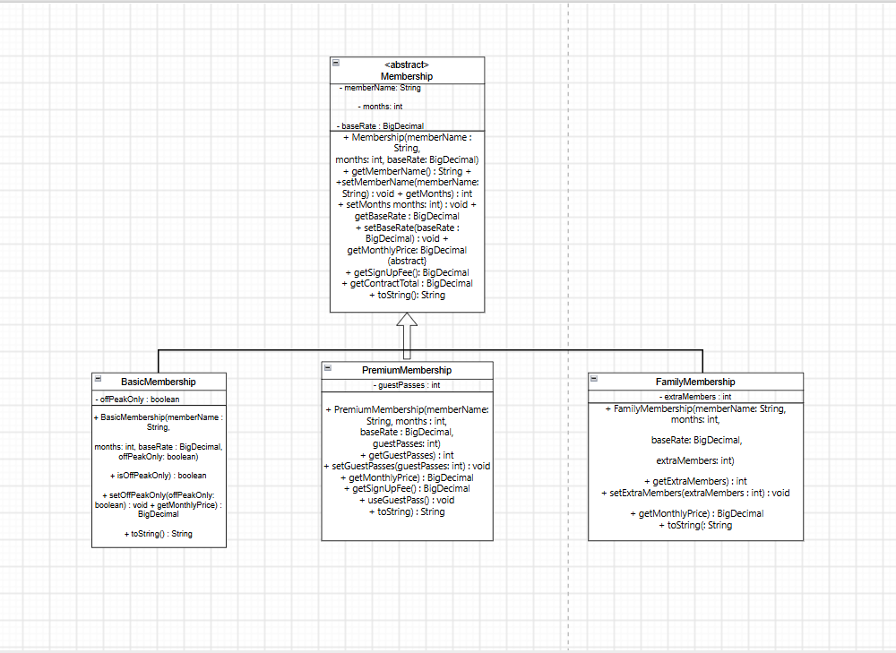
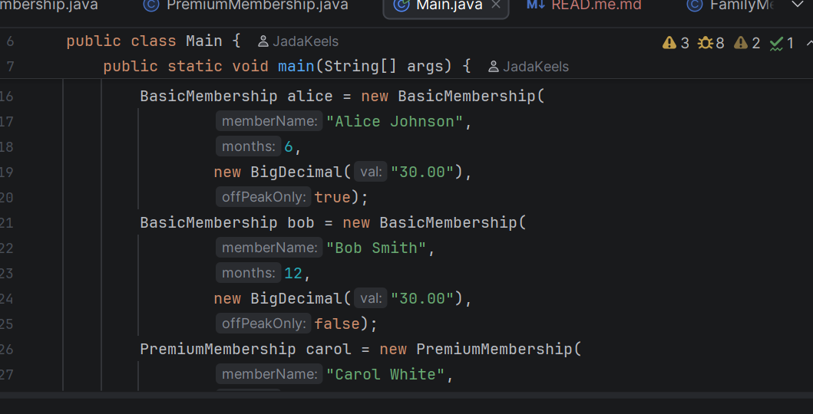
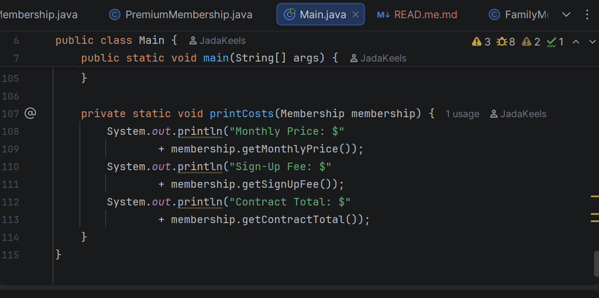

# Gym Memberships

## Description of the Project


A Java inheritance and polymorphism project that models different types of gym memberships. This application demonstrates abstract classes, inheritance, method overriding, polymorphism, collections, and type checking using `instanceof`.

## Class Diagram



## Features

- Basic Membership: Standard gym membership, Optional off-peak access only, $5 discount for off-peak members
- Premium Membership: Premium facility access, guest passes, additional monthly fee, free signup fee for 12-month contracts
- Family Membership: Supports additional family members, additional monthly cost per family member, 10% discount for families with 3 or more extra members

## Setup

### Prerequisites

- Java 17 (Amazon Corretto), the version used in class.
- IntelliJ IDEA Community Edition: <https://www.jetbrains.com/idea/download/>

### Running the application

1. Clone this repository, or download it as a zip and unzip it.
2. In IntelliJ: File > Open, pick the project folder (the one that holds `pom.xml`), press Open.
3. Wait for IntelliJ to finish indexing (progress bar at the bottom).
4. Open `src/main/java/com/pluralsight/Main.java`.
5. Right-click inside the file and choose Run 'Main.java'.


## Technologies Used

- Java 17
- IntelliJ IDEA


## Demo



## A piece of code I am proud of


```java 
ArrayList<Membership> memberships = new ArrayList<>();
memberships.add(alice);
memberships.add(bob);
memberships.add(carol);
memberships.add(frank);
memberships.add(grace);
memberships.add(emma);

```

I am proud of this code because it demonstrates polymorphism by allowing different membership types to be stored in the same collection. Even though each object is treated as a Membership, Java automatically calls the correct overridden methods at runtime.

## Future Work

- Input validation 
- Improve monetary values 

## Resources

- Java YearUp Fall 2026 hub: <https://raymaroun.github.io/yearup-java-fall2026/>
- Java.Focus https://yearup.brightspace.com/d2l/le/enhancedSequenceViewer/12949?url=https%3A%2F%2Fa8aef0e2-4090-467b-bc7e-c872d64ba733.sequences.api.brightspace.com%2F12949%2Factivity%2F662706%3FfilterOnDatesAndDepth%3D1

## Author

- **Jada Keels**
Software Student
## Thanks

- Thank you to Raymond and my peers for feedback and assistance. 
